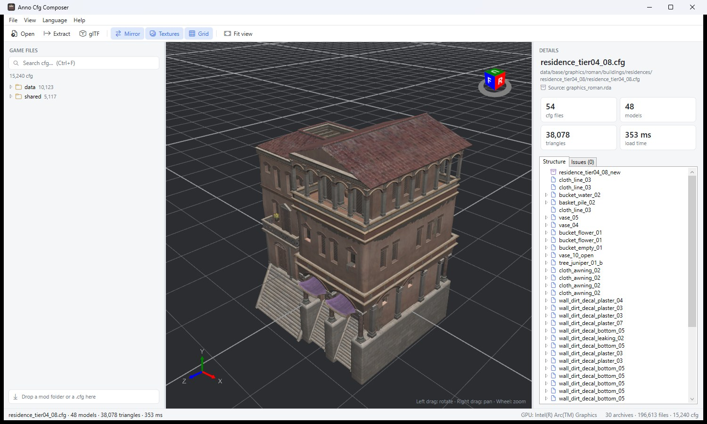
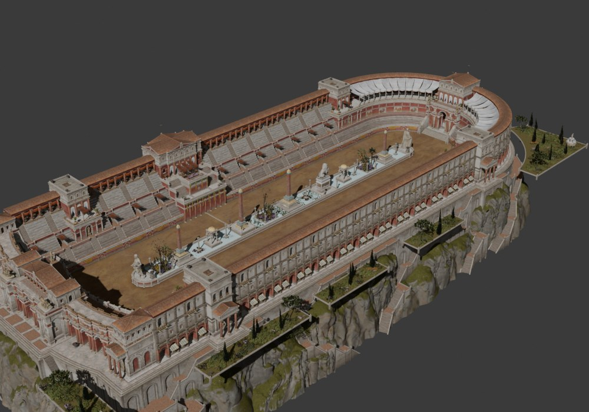

<p align="center">
  
</p>

<h1 align="center">Anno Cfg Composer</h1>

<p align="center">
  <b>Browse, view in 3D, extract and export the building graphics of Anno 117: Pax Romana — straight from your game installation</b>
</p>

<p align="center">
  <a href="https://github.com/FreeJ85/anno-cfg-composer/releases/latest"></a>
  <a href="https://github.com/FreeJ85/anno-cfg-composer/releases"></a>
  
  <a href="LICENSE"></a>
</p>

<p align="center">
  <a href="#english">English</a> · <a href="#deutsch">Deutsch</a> · <a href="#한국어">한국어</a>
</p>

<p align="center">
  
</p>

## English

A tool for modders. It opens the game's `.rda` archives directly, lists every graphics `.cfg` (buildings, props, plants, ships …) and shows it in 3D with all its props and textures. Nothing has to be unpacked first.

### Features

- **All graphics cfg of the installed game** — about 15,000, as a folder tree with search. Patch archives are applied in game order, so you always see the current version.
- **3D view** (Direct3D 11) — props are followed recursively, textures are loaded from the game, leaves, ropes and grilles are cut out by their alpha like in the game.
- **Structure and issues** — a tree of the props and models a cfg is made of, and a list of files that could not be found or read.
- **Extract with dependencies** — the cfg plus every file it uses (prop cfgs, `.rdm` models, `.dds` textures, `.ifo` / `.fc`), keeping the `data/…` folder structure.
- **Export to glTF** (`.glb`) — one file with the whole building, its props as a node hierarchy and its textures. Blender opens it without add-ons: *File → Import → glTF 2.0*.
- **Mod folders** — drag a mod folder onto the list. Its cfgs are shown on top; files are taken from the mod first, everything else from the game.
- English · Deutsch · 한국어

<p align="center">
  
  <br><sub>The hippodrome exported to <code>.glb</code> and rendered in Blender</sub>
</p>

### Download and start

1. Download `AnnoCfgComposer-<version>-win-x64.zip` from [Releases](https://github.com/FreeJ85/anno-cfg-composer/releases/latest).
2. Unzip it into any folder and run `AnnoCfgComposer.exe`. Nothing needs to be installed (the .NET runtime is included).
   If Windows says "Windows protected your PC", click **More info → Run anyway** (the program isn't code-signed).
3. The game folder is found automatically (Steam or Ubisoft Connect). If not: *File → Game folder…*

Requirements: Windows 10 or 11 (64-bit), a DirectX 11 graphics card, Anno 117: Pax Romana installed.

### Controls

| | |
|---|---|
| Left drag / right drag / wheel | rotate / pan / zoom |
| `F` | fit the view |
| `Ctrl+F` | search |
| `Ctrl+O` | open a `.cfg` from disk |
| `Ctrl+E` | extract with dependencies |
| `Ctrl+G` | export glTF |

### Good to know

- **Mirror** — Anno uses a left-handed coordinate system, so the view mirrors the X axis. If a building looks mirrored compared to the game, turn *Mirror* off.
- **`data/` and `shared/`** — `shared/` holds versions added by patches in which the props are already merged into one model. They look the same; for editing, use `data/`.
- **Not shown yet** — decals, particles (fire, smoke) and animations. Planes that only cut out terrain or water are hidden, as in the game.
- **Laptops with two graphics cards** — the card connected to the display is used (*View → Graphics card*).

### Troubleshooting

- **The program stops with an error** — details are saved in `%LOCALAPPDATA%\AnnoCfgComposer\logs` (*Help → Open error log folder*). Please attach that file when you report a problem.
- **Settings** — `%APPDATA%\AnnoCfgComposer\settings.json`. Delete it to start fresh.

### Copyright

The models and textures of Anno 117: Pax Romana are copyrighted by Ubisoft. This program only reads them from your own installation and contains none of them.

- Use the files you extract or export **only for your own modding and learning**. **Do not redistribute** them (no uploads of `.glb`, `.rdm` or `.dds` files from the game).
- In mods, reference the original game paths (`data/base/…`) instead of copying game files into the mod.

### Building from source

Requires the .NET 10 SDK.

```
dotnet build
dotnet publish -c Release -o dist
```

`AnnoCfgComposer.exe --selftest <folder> [cfg …]` reads all archives, parses a sample of cfgs and renders the given cfgs to PNG, without user interaction.

---

## Deutsch

Ein Werkzeug für Modder. Es öffnet die `.rda`-Archive des Spiels direkt, listet jede Grafik-`.cfg` (Gebäude, Props, Pflanzen, Schiffe …) und zeigt sie in 3D mit allen Props und Texturen. Nichts muss vorher entpackt werden.

<details>
<summary><b>Funktionen · Download · Bedienung</b></summary>

### Funktionen

- **Alle Grafik-cfg des installierten Spiels** — rund 15.000, als Ordnerbaum mit Suche. Patch-Archive werden in Spielreihenfolge angewendet, man sieht immer die aktuelle Version.
- **3D-Ansicht** (Direct3D 11) — Props werden rekursiv verfolgt, Texturen aus dem Spiel geladen, Blätter, Seile und Gitter wie im Spiel per Alpha ausgeschnitten.
- **Aufbau und Probleme** — ein Baum der Props und Modelle einer cfg und eine Liste nicht gefundener oder nicht lesbarer Dateien.
- **Mit Abhängigkeiten extrahieren** — die cfg und jede Datei, die sie nutzt (Prop-cfgs, `.rdm`-Modelle, `.dds`-Texturen, `.ifo` / `.fc`), mit der `data/…`-Ordnerstruktur.
- **Als glTF exportieren** (`.glb`) — eine Datei mit dem ganzen Gebäude, den Props als Knotenhierarchie und den Texturen. Blender öffnet sie ohne Add-on: *Datei → Importieren → glTF 2.0*.
- **Mod-Ordner** — einen Mod-Ordner auf die Liste ziehen. Seine cfgs stehen oben; Dateien kommen zuerst aus der Mod, der Rest aus dem Spiel.
- English · Deutsch · 한국어

### Download und Start

1. `AnnoCfgComposer-<Version>-win-x64.zip` aus [Releases](https://github.com/FreeJ85/anno-cfg-composer/releases/latest) herunterladen.
2. In einen beliebigen Ordner entpacken und `AnnoCfgComposer.exe` starten. Keine Installation nötig (.NET-Laufzeit enthalten).
   Bei „Der Computer wurde durch Windows geschützt“ auf **Weitere Informationen → Trotzdem ausführen** klicken (nicht signiert).
3. Der Spielordner wird automatisch gefunden (Steam oder Ubisoft Connect). Sonst: *Datei → Spielordner…*

Voraussetzungen: Windows 10 oder 11 (64 Bit), DirectX-11-Grafikkarte, installiertes Anno 117: Pax Romana.

### Bedienung

| | |
|---|---|
| Links ziehen / rechts ziehen / Rad | drehen / verschieben / zoomen |
| `F` | Ansicht einpassen |
| `Strg+F` | Suche |
| `Strg+O` | `.cfg` von der Festplatte öffnen |
| `Strg+E` | mit Abhängigkeiten extrahieren |
| `Strg+G` | glTF exportieren |

### Gut zu wissen

- **Spiegeln** — Anno nutzt ein linkshändiges Koordinatensystem, daher spiegelt die Ansicht die X-Achse. Wirkt ein Gebäude im Vergleich zum Spiel gespiegelt, *Spiegeln* ausschalten.
- **`data/` und `shared/`** — `shared/` enthält per Patch hinzugefügte Fassungen, in denen die Props schon zu einem Modell zusammengefügt sind. Sie sehen gleich aus; zum Bearbeiten `data/` nehmen.
- **Noch nicht angezeigt** — Decals, Partikel (Feuer, Rauch) und Animationen. Flächen, die nur Gelände oder Wasser ausschneiden, sind wie im Spiel unsichtbar.
- **Laptops mit zwei Grafikkarten** — es wird die Karte am Bildschirm benutzt (*Ansicht → Grafikkarte*).

### Probleme

- **Das Programm bricht mit einem Fehler ab** — Details stehen in `%LOCALAPPDATA%\AnnoCfgComposer\logs` (*Hilfe → Fehlerprotokoll-Ordner öffnen*). Bitte diese Datei beim Melden anhängen.
- **Einstellungen** — `%APPDATA%\AnnoCfgComposer\settings.json`. Löschen setzt alles zurück.

### Urheberrecht

Die Modelle und Texturen von Anno 117: Pax Romana sind urheberrechtlich geschützt (Ubisoft). Das Programm liest sie nur aus deiner eigenen Installation und enthält keine davon.

- Extrahierte oder exportierte Dateien **nur für eigenes Modding und zum Lernen** verwenden und **nicht weiterverbreiten** (keine Uploads von `.glb`-, `.rdm`- oder `.dds`-Dateien aus dem Spiel).
- In Mods auf die Originalpfade des Spiels (`data/base/…`) verweisen, statt Spieldateien in die Mod zu kopieren.

</details>

---

## 한국어

모더를 위한 도구입니다. 게임의 `.rda` 아카이브를 직접 열어 그래픽 `.cfg`(건물, 소품, 식물, 배 …)를 전부 보여 주고, 소품과 텍스처까지 3D 로 그립니다. 미리 압축을 풀 필요가 없습니다.

<details>
<summary><b>기능 · 받기 · 사용법</b></summary>

### 기능

- **설치된 게임의 그래픽 cfg 전부** — 약 15,000개를 폴더 트리와 검색으로. 패치 아카이브를 게임 순서대로 반영해 늘 최신판이 보입니다.
- **3D 보기** (Direct3D 11) — 소품을 따라 들어가 모두 그리고, 텍스처는 게임에서 읽고, 잎·밧줄·창살은 게임처럼 알파로 잘라 냅니다.
- **구성과 문제** — cfg 를 이루는 소품·모델 트리, 못 찾거나 읽지 못한 파일 목록.
- **딸린 파일과 함께 추출** — cfg 와 그것이 쓰는 파일 전부(소품 cfg, `.rdm` 모델, `.dds` 텍스처, `.ifo` / `.fc`)를 `data/…` 폴더 구조 그대로.
- **glTF 로 내보내기** (`.glb`) — 건물 전체를 파일 하나로. 소품은 노드 계층으로, 텍스처도 함께. Blender 가 애드온 없이 엽니다: *File → Import → glTF 2.0*.
- **모드 폴더** — 모드 폴더를 목록에 끌어다 놓으면 그 cfg 들이 맨 위에 나옵니다. 파일은 모드에서 먼저 찾고, 나머지는 게임에서.
- English · Deutsch · 한국어

### 받기와 실행

1. [Releases](https://github.com/FreeJ85/anno-cfg-composer/releases/latest) 에서 `AnnoCfgComposer-<버전>-win-x64.zip` 받기.
2. 아무 폴더에 풀고 `AnnoCfgComposer.exe` 실행. 설치할 것은 없습니다 (.NET 런타임 포함).
   "Windows의 PC 보호" 가 뜨면 **추가 정보 → 실행** (코드 서명이 없어서).
3. 게임 폴더는 자동으로 찾습니다 (Steam 또는 Ubisoft Connect). 못 찾으면 *파일 → 게임 폴더…*

필요한 것: Windows 10 또는 11 (64비트), DirectX 11 그래픽 카드, Anno 117: Pax Romana.

### 조작

| | |
|---|---|
| 왼쪽 드래그 / 오른쪽 드래그 / 휠 | 회전 / 이동 / 확대 |
| `F` | 전체 보기 |
| `Ctrl+F` | 검색 |
| `Ctrl+O` | 디스크의 `.cfg` 열기 |
| `Ctrl+E` | 딸린 파일과 함께 추출 |
| `Ctrl+G` | glTF 로 내보내기 |

### 알아 두면 좋은 것

- **좌우 반전** — Anno 는 왼손 좌표계라 화면은 X 축을 뒤집어 그립니다. 게임과 좌우가 반대로 보이면 *좌우 반전* 을 끄세요.
- **`data/` 와 `shared/`** — `shared/` 는 패치가 넣은, 소품을 미리 하나의 모델로 합친 판입니다. 모양은 같고, 편집할 때는 `data/` 쪽을 쓰세요.
- **아직 안 그리는 것** — 데칼, 파티클(불·연기), 애니메이션. 땅·물을 도려내기만 하는 평면은 게임처럼 숨깁니다.
- **그래픽 카드가 둘인 노트북** — 화면에 연결된 카드를 씁니다 (*보기 → 그래픽 카드*).

### 문제가 생기면

- **오류로 멈출 때** — `%LOCALAPPDATA%\AnnoCfgComposer\logs` 에 내용이 저장됩니다 (*도움말 → 오류 기록 폴더 열기*). 알려 주실 때 그 파일을 함께 보내 주세요.
- **설정** — `%APPDATA%\AnnoCfgComposer\settings.json`. 지우면 처음 상태로 돌아갑니다.

### 저작권

Anno 117: Pax Romana 의 모델과 텍스처는 Ubisoft 의 저작물입니다. 이 프로그램은 사용자 PC 에 설치된 게임에서 읽기만 하며, 게임 파일을 하나도 담고 있지 않습니다.

- 추출하거나 내보낸 파일은 **개인 모딩과 학습에만** 쓰고 **재배포하지 마세요** (게임에서 나온 `.glb`, `.rdm`, `.dds` 파일을 올리지 말 것).
- 모드에서는 게임 파일을 복사해 넣지 말고 원본 경로(`data/base/…`)를 참조하세요.

</details>

---

<sub>MIT License · [Third-party notices](THIRD-PARTY-NOTICES.md) · Fan-made tool, not affiliated with Ubisoft. Anno is a trademark of Ubisoft Entertainment. Game models and textures are copyrighted by Ubisoft — the program contains none of them; do not redistribute extracted or exported files.</sub>
